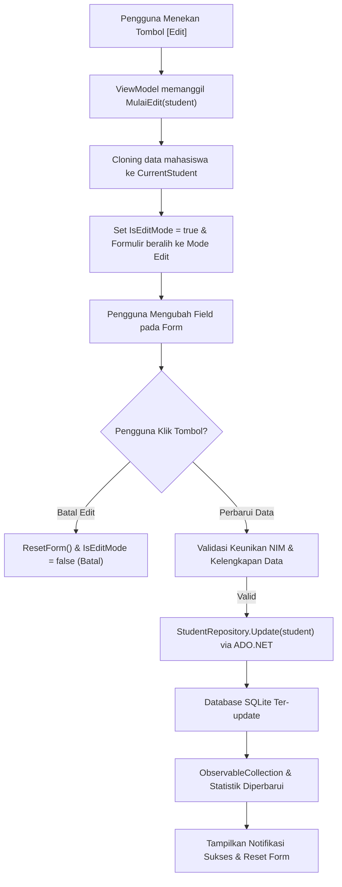

# LAPORAN TUGAS Pertemuan 4: PENGEMBANGAN APLIKASI DESKTOP WPF
**Topik:** Sistem Manajemen Data Mahasiswa Berbasis WPF

* **Nama:** Raihan Rasyid Ramadhan
* **NRP:** 5025241224
* **Mata Kuliah:** Pemrograman Berbasis Kerangka Kerja
* **Teknologi:** C# (.NET 8), WPF (Windows Presentation Foundation), Avalonia UI, SQLite (ADO.NET)

---

## 1. Deskripsi Umum Sistem

Sistem Manajemen Data Mahasiswa adalah aplikasi desktop modern yang dibangun menggunakan framework **WPF (Windows Presentation Foundation)** dan pola desain arsitektur **MVVM (Model - View - ViewModel)**. Aplikasi ini dirancang untuk mengelola data induk mahasiswa secara terpadu, mencakup identitas diri (NIM, Nama, Program Studi/Jurusan, Nomor Telepon, Email, dan Alamat Domisili).

---

## 2. Struktur Code

Struktur kode proyek dirancang bersih (*clean*), ramping, dan modular sesuai standar arsitektur terpusat:

```text
student_management_system_wps/
├── Student.cs           # Model mahasiswa (INotifyPropertyChanged & Deep Clone)
├── StudentRepository.cs # Akses database ADO.NET SQLite (Operasi CRUD & Search)
├── RelayCommand.cs      # Implementasi ICommand untuk binding interaksi MVVM
├── StudentViewModel.cs  # ViewModel (ObservableCollection, Perintah CRUD, Statistik)
├── MainWindow.xaml      # UI (Header, Info Panel, Form Tambah/Edit, Search, DataGrid)
├── MainWindow.xaml.cs   # Code-behind murni (DataContext = new StudentViewModel())
├── App.xaml             # Konfigurasi aplikasi & StartupUri
└── CampusApp.csproj     # Konfigurasi proyek .NET 8 WPF & Package Microsoft.Data.Sqlite
```

---

## 3. Implementasi Fitur Update / Edit Data Mahasiswa

Fitur Update data mahasiswa diimplementasikan melalui sinergi 4 layer:

### Alur Kerja (Workflow) Mode Edit:
1. **Inisiasi Edit:** Pengguna memilih data mahasiswa pada tabel dan menekan tombol **`[✏️ Edit]`** pada baris tabel atau tombol **`[✏️ Edit Data Mahasiswa]`** pada panel kontrol.
2. **Isolasi Data (Cloning):** Objek mahasiswa yang dipilih disalin menggunakan method `.Clone()` ke dalam properti `CurrentStudent`. Hal ini mencegah formulir langsung memodifikasi data tabel sebelum pengguna mengonfirmasi penyimpanan.
3. **Transisi Status Antarmuka:** 
   - Properti `IsEditMode` bernilai `true`.
   - Judul formulir berganti dari *"Tambah Mahasiswa Baru"* menjadi *"Edit Data Mahasiswa"*.
   - Badge visual *"✏️ Mode Edit Aktif"* ditampilkan.
   - Tombol simpan berganti warna dan label menjadi *"Perbarui Data (Update)"*.
   - Tombol *"✕ Batal Edit"* ditampilkan untuk opsi pembatalan.
4. **Validasi & Eksekusi Update:**
   - Memastikan seluruh isian wajib terisi dengan benar.
   - Memastikan NIM tidak bentrok dengan mahasiswa lain (`IsNimExists(nim, excludeId)`).
   - Menjalankan perintah SQL `UPDATE` melalui ADO.NET parameterized query.
5. **Sinkronisasi Otomatis:** Tabel `ObservableCollection` diperbarui dan statistik dihitung ulang secara instan.



---

## 4. Pembahasan Detail Kode Sumber

### 1. Model Data (`Student.cs`)
Mengimplementasikan interface `INotifyPropertyChanged` untuk mendukung two-way data binding ke elemen UI. Method `Clone()` diterapkan untuk mengisolasi data saat proses penyuntingan:
```csharp
public class Student : INotifyPropertyChanged
{
    private int _id;
    private string _nim = string.Empty;
    private string _nama = string.Empty;
    private string _jurusan = "Teknik Informatika";
    private string _email = string.Empty;
    private string _noHp = string.Empty;
    private string _alamat = string.Empty;

    // Properti-properti dengan pemanggilan SetProperty/OnPropertyChanged...

    public Student Clone()
    {
        return new Student
        {
            Id = this.Id,
            Nim = this.Nim,
            Nama = this.Nama,
            Jurusan = this.Jurusan,
            Email = this.Email,
            NoHp = this.NoHp,
            Alamat = this.Alamat
        };
    }
}
```

### 2. Akses Database ADO.NET (`StudentRepository.cs`)
Menggunakan ADO.NET murni (`SqliteConnection`, `SqliteCommand`, `SqliteDataReader`, `SqliteParameter`) untuk memastikan efisiensi tinggi tanpa ketergantungan ORM yang berat.

* **Inisialisasi & Seeder:** Membuat tabel `Students` dan mengisi contoh data otomatis jika database kosong.
* **Operasi Update:** Menggunakan parameterized query untuk mengamankan data dari serangan SQL Injection:
```csharp
public bool Update(Student student)
{
    using var connection = new SqliteConnection(_connectionString);
    connection.Open();

    string query = @"
        UPDATE Students
        SET Nim = @Nim,
            Nama = @Nama,
            Jurusan = @Jurusan,
            Email = @Email,
            NoHp = @NoHp,
            Alamat = @Alamat
        WHERE Id = @Id;
    ";

    using var cmd = new SqliteCommand(query, connection);
    cmd.Parameters.AddWithValue("@Id", student.Id);
    cmd.Parameters.AddWithValue("@Nim", student.Nim?.Trim() ?? string.Empty);
    cmd.Parameters.AddWithValue("@Nama", student.Nama?.Trim() ?? string.Empty);
    cmd.Parameters.AddWithValue("@Jurusan", student.Jurusan?.Trim() ?? string.Empty);
    cmd.Parameters.AddWithValue("@Email", student.Email?.Trim() ?? string.Empty);
    cmd.Parameters.AddWithValue("@NoHp", student.NoHp?.Trim() ?? string.Empty);
    cmd.Parameters.AddWithValue("@Alamat", student.Alamat?.Trim() ?? string.Empty);

    int rowsAffected = cmd.ExecuteNonQuery();
    return rowsAffected > 0;
}
```

### 3. Binding Perintah (`RelayCommand.cs`)
Implementasi antarmuka `ICommand` standar yang mendelegasikan eksekusi aksi (*Action*) dan pemeriksaan status eksekusi (*Predicate CanExecute*) langsung ke ViewModel.

### 4. Logika Bisnis (`StudentViewModel.cs`)
Menghubungkan View dengan Model dan Database:
* **Logika Penyimpanan Dinamis:**
```csharp
private void Simpan()
{
    // 1. Validasi Input Dasar
    if (string.IsNullOrWhiteSpace(CurrentStudent.Nim) || string.IsNullOrWhiteSpace(CurrentStudent.Nama))
    {
        SetStatus("NIM dan Nama Lengkap wajib diisi!", isError: true);
        return;
    }

    if (!IsEditMode)
    {
        // CREATE / TAMBAH DATA
        if (_repository.IsNimExists(CurrentStudent.Nim))
        {
            SetStatus($"Gagal: Mahasiswa dengan NIM '{CurrentStudent.Nim}' sudah terdaftar!", isError: true);
            return;
        }

        _repository.Insert(CurrentStudent);
        SetStatus($"Berhasil: Mahasiswa '{CurrentStudent.Nama}' berhasil ditambahkan.", isError: false);
    }
    else
    {
        // UPDATE / EDIT DATA
        if (_repository.IsNimExists(CurrentStudent.Nim, CurrentStudent.Id))
        {
            SetStatus($"Gagal: NIM '{CurrentStudent.Nim}' sudah digunakan oleh mahasiswa lain!", isError: true);
            return;
        }

        _repository.Update(CurrentStudent);
        SetStatus($"Berhasil: Data mahasiswa '{CurrentStudent.Nama}' berhasil diperbarui!", isError: false);
    }

    ResetForm();
    LoadData(); // Muat ulang data terbaru & hitung statistik
}
```

* **Statistik Dinamis Real-Time:** Menghitung total mahasiswa, jumlah program studi aktif, serta mendeteksi jurusan yang memiliki jumlah mahasiswa terbanyak secara otomatis setiap kali data berubah.

### 5. Antarmuka Pengguna (`MainWindow.xaml` & `RegistrasiView.axaml`)
* **Header & Status Panel:** Menampilkan identitas sistem serta indikator koneksi database.
* **Kartu Statistik:** 3 card ringkasan di bagian atas.
* **Panel Formulir Input:** Dilengkapi kontrol validasi, ComboBox pilihan jurusan, serta tombol Simpan/Update yang adaptif.
* **Tabel Data:** Menampilkan daftar mahasiswa dengan kolom aksi yang berisi tombol **Edit** dan **Hapus**.

---

## 5. Hasil Pengujian Fungsional (Test Cases)

| No | Skenario Pengujian | Aksi yang Dilakukan | Hasil yang Diharapkan | Status |
|:--:|:-------------------|:-------------------|:----------------------|:------:|
| 1 | Tambah Mahasiswa Baru | Mengisi seluruh form dan klik **Simpan Mahasiswa** | Data tersimpan ke SQLite, muncul di tabel, statistik bertambah | **PASSED** |
| 2 | Validasi NIM Duplikat | Menambah mahasiswa dengan NIM yang sudah ada | Sistem menolak dengan pesan *"NIM sudah terdaftar"* | **PASSED** |
| 3 | Mengaktifkan Mode Edit | Klik tombol **`[Edit]`** pada baris tabel | Formulir terisi data mahasiswa terkait, judul berganti *"Edit Data Mahasiswa"*, tombol berubah jadi *"Perbarui Data"* | **PASSED** |
| 4 | Pembaruan Data Mahasiswa | Mengubah Nama/Jurusan lalu klik **Perbarui Data** | Query `UPDATE` berhasil dieksekusi, data di tabel ter-update seketika | **PASSED** |
| 5 | Pembatalan Edit | Klik tombol **`[✕ Batal Edit]`** saat mode edit aktif | Formulir di-reset, sistem kembali ke mode tambah biasa | **PASSED** |
| 6 | Hapus Data Mahasiswa | Klik tombol **`[Hapus]`** | Muncul kotak dialog konfirmasi (`MessageBox`), data terhapus jika dipilih *Yes* | **PASSED** |
| 7 | Pencarian Mahasiswa | Mengetik kata kunci (NIM/Nama/Jurusan) di kolom cari | Tabel memfilter data yang cocok secara langsung | **PASSED** |

---

## 6. Petunjuk Menjalankan Aplikasi

Aplikasi mendukung dua platform eksekusi:

### A. Eksekusi pada Sistem Operasi Windows (WPF Native)
1. Buka folder `student_management_system_wps` atau `WPF_Windows` di Windows (Visual Studio / Terminal).
2. Jalankan perintah:
   ```cmd
   dotnet run
   ```
3. Jendela WPF akan muncul dan file database lokal `students.db` otomatis dibuat.

### B. Eksekusi pada Sistem Operasi Linux / Ubuntu (Avalonia Native)
Karena WPF terikat pada library Windows, versi cross-platform disediakan pada direktori `WPF/`:
```bash
cd ~/code/WPF
dotnet run
```
Aplikasi GUI akan langsung berjalan secara native pada layar Ubuntu Linux.

---

## 7. Dokumentasi Tangkapan Layar (Screenshots) Aplikasi

Berikut adalah dokumentasi hasil uji coba eksekusi antarmuka aplikasi:

### 1. Tampilan Awal (Halaman Utama, Statistik, dan Data Mahasiswa)


---

### 2. Tambah Data (Pengisian Form & Penyimpanan Mahasiswa Baru)


---

### 3. Hapus Data (Konfirmasi & Penghapusan Mahasiswa)


---

### 4. Edit Data (Aktivasi Mode Edit & Pembaruan Mahasiswa)


---

