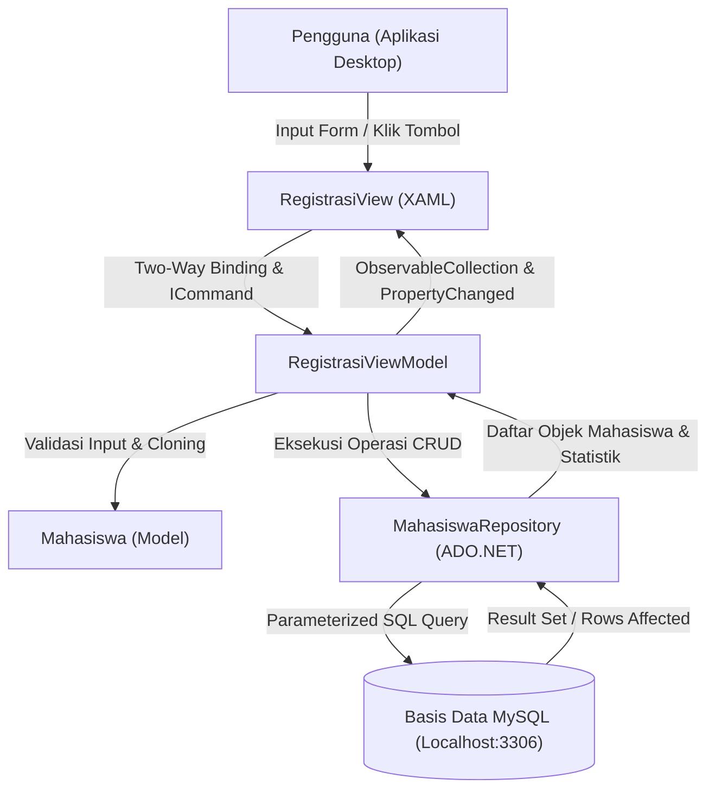

# LAPORAN TUGAS: PENGEMBANGAN APLIKASI REGISTRASI MAHASISWA BERBASIS MVVM & MYSQL

**Topik:** Sistem Registrasi & Manajemen Mahasiswa Terintegrasi MySQL  
**Nama:** Raihan Rasyid Ramadhan  
**NRP:** 5025241224  
**Pertemuan:** 5     
**Mata Kuliah:** Pemrograman Berbasis Kerangka Kerja (PBKK)  
**Teknologi:** C# (.NET 8), MVVM Pattern, MySqlConnector (ADO.NET), Avalonia UI & WPF  

---

## 1. Deskripsi Umum Sistem

Sistem Registrasi Mahasiswa (SISMA) adalah aplikasi desktop modern yang mengimplementasikan pola arsitektur **MVVM (Model - View - ViewModel)** dan terhubung langsung ke basis data relasional **MySQL**. Sistem ini menggantikan penyimpanan data statis (*in-memory*) dan SQLite lokal dari modul sebelumnya menjadi basis data relasional terpusat berskala produksi.

Aplikasi ini mencakup fitur:
1. **Registrasi Mahasiswa Baru (Create):** Validasi format isian (NIM unik, Nama lengkap, Program Studi, Jenis Kelamin, Email, Nomor Telepon/WhatsApp, Alamat).
2. **Penyajian Data Real-Time (Read):** Menampilkan seluruh entri mahasiswa dari tabel MySQL dengan format kartu ringkas, avatar inisial otomatis, dan badge dinamis.
3. **Pembaruan Data Mahasiswa (Update):** Mekanisme isolasi penyuntingan (*cloning*) untuk menjaga integritas data sebelum konfirmasi penyimpanan.
4. **Penghapusan Data (Delete):** Menghapus data spesifik berdasarkan *Primary Key* `id` dan `nim` secara langsung di basis data MySQL.
5. **Pencarian Cepat (Search & Filter):** Pencarian instan berdasarkan NIM, Nama, atau Program Studi menggunakan klausa SQL `LIKE`.
6. **Panel Ringkasan Statistik Akademik:** Menghitung jumlah total mahasiswa, total program studi aktif, serta jurusan dengan pendaftar terbanyak secara *real-time*.
7. **Indikator Status Koneksi MySQL:** Menampilkan status konektivitas basis data secara visual.

---

## 2. Struktur Arsitektur MVVM & Folder Proyek

```text
code/
├── registrasi_mahasiswa.sql              # Skrip SQL: DDL Tabel, DML Seeder, & View Statistik
│
├── WPF/                                  # Versi Desktop Cross-Platform (Linux/Ubuntu & Windows)
│   ├── CampusApp.csproj                  # Project file .NET 8 (Paket: MySqlConnector, Avalonia)
│   ├── Models/
│   │   └── Mahasiswa.cs                  # Model Mahasiswa (INotifyPropertyChanged, IDataErrorInfo, Clone)
│   ├── Repositories/
│   │   └── MahasiswaRepository.cs        # ADO.NET MySQL (CRUD, Param Queries, Auto-Seed, Stats)
│   ├── ViewModels/
│   │   ├── ViewModelBase.cs              # Kelas dasar ViewModel (INotifyPropertyChanged helper)
│   │   ├── RelayCommand.cs               # Implementasi ICommand untuk Data Binding
│   │   └── RegistrasiViewModel.cs        # ViewModel Registrasi (Logic CRUD, Search, Notifikasi)
│   └── Views/
│       ├── RegistrasiView.axaml          # Desain UI XAML Formulir Registrasi & Tabel MySQL
│       └── RegistrasiView.axaml.cs       # Code-Behind murni tanpa logika bisnis
│
└── student_management_system_wpf/        # Versi WPF Native (.NET 8 Windows)
    ├── StudentManagementSystem.csproj    # Target net8.0-windows + MySqlConnector
    ├── IStudentRepository.cs             # Antarmuka Abstraksi Repository
    ├── MySqlStudentRepository.cs         # Implementasi ADO.NET MySQL
    ├── StudentRepository.cs              # Implementasi ADO.NET SQLite (Fallback)
    ├── StudentViewModel.cs               # ViewModel WPF
    └── MainWindow.xaml                   # Antarmuka WPF Native
```

---

## 3. Skema Basis Data MySQL (`mahasiswa`)

Tabel dirancang dengan prinsip normalisasi data relasional:

```sql
CREATE TABLE IF NOT EXISTS mahasiswa (
    id INT AUTO_INCREMENT PRIMARY KEY,
    nim VARCHAR(20) NOT NULL UNIQUE,
    nama VARCHAR(150) NOT NULL,
    program_studi VARCHAR(100) NOT NULL,
    tanggal_lahir DATE NULL,
    jenis_kelamin ENUM('Laki-laki', 'Perempuan') NOT NULL DEFAULT 'Laki-laki',
    email VARCHAR(100) NULL,
    no_hp VARCHAR(20) NULL,
    alamat TEXT NULL,
    waktu_daftar DATETIME NOT NULL DEFAULT CURRENT_TIMESTAMP,
    created_at TIMESTAMP DEFAULT CURRENT_TIMESTAMP,
    updated_at TIMESTAMP DEFAULT CURRENT_TIMESTAMP ON UPDATE CURRENT_TIMESTAMP,
    INDEX idx_nim (nim),
    INDEX idx_nama (nama),
    INDEX idx_prodi (program_studi)
) ENGINE=InnoDB DEFAULT CHARSET=utf8mb4;
```

---

## 4. Alur Kerja Arsitektur MVVM



---

## 5. Pembahasan Detail Implementasi Kode Sumber

### 1. Model Data (`Mahasiswa.cs`)
Mengimplementasikan interface `INotifyPropertyChanged` untuk pembaruan UI otomatis dan `IDataErrorInfo` untuk memvalidasi isian (Nama minimal 3 karakter, NIM hanya berupa angka, nomor telepon berformat valid, serta validasi usia). Dilengkapi method `Clone()` untuk mencegah *side-effect* perubahan data tabel sebelum konfirmasi penyimpanan:

```csharp
public Mahasiswa Clone()
{
    return new Mahasiswa
    {
        Id = this.Id,
        Nama = this.Nama,
        Nim = this.Nim,
        ProgramStudi = this.ProgramStudi,
        TanggalLahir = this.TanggalLahir,
        JenisKelamin = this.JenisKelamin,
        Email = this.Email,
        Alamat = this.Alamat,
        NoTelepon = this.NoTelepon,
        WaktuDaftar = this.WaktuDaftar
    };
}
```

### 2. Akses Basis Data ADO.NET MySQL (`MahasiswaRepository.cs`)
Menggunakan library **`MySqlConnector`** untuk eksekusi kueri terparameter (*parameterized query*) guna menjamin perlindungan terhadap serangan SQL Injection:

* **Pemeriksaan Keunikan NIM:**
```csharp
public bool IsNimExists(string nim, int? excludeId = null)
{
    using var connection = new MySqlConnection(_connectionString);
    connection.Open();

    string query = "SELECT COUNT(*) FROM mahasiswa WHERE nim = @nim";
    if (excludeId.HasValue && excludeId.Value > 0)
    {
        query += " AND id != @excludeId";
    }
    query += ";";

    using var cmd = new MySqlCommand(query, connection);
    cmd.Parameters.AddWithValue("@nim", nim.Trim());
    if (excludeId.HasValue && excludeId.Value > 0)
    {
        cmd.Parameters.AddWithValue("@excludeId", excludeId.Value);
    }

    long count = Convert.ToInt64(cmd.ExecuteScalar() ?? 0);
    return count > 0;
}
```

* **Operasi Simpan Data Baru (Insert):**
```csharp
public int Insert(Mahasiswa m)
{
    using var connection = new MySqlConnection(_connectionString);
    connection.Open();

    string query = @"
        INSERT INTO mahasiswa (nim, nama, program_studi, tanggal_lahir, jenis_kelamin, email, no_hp, alamat, waktu_daftar)
        VALUES (@nim, @nama, @program_studi, @tanggal_lahir, @jenis_kelamin, @email, @no_hp, @alamat, @waktu_daftar);
        SELECT LAST_INSERT_ID();
    ";

    using var cmd = new MySqlCommand(query, connection);
    cmd.Parameters.AddWithValue("@nim", m.Nim.Trim());
    cmd.Parameters.AddWithValue("@nama", m.Nama.Trim());
    cmd.Parameters.AddWithValue("@program_studi", m.ProgramStudi.Trim());
    cmd.Parameters.AddWithValue("@tanggal_lahir", m.TanggalLahir.HasValue ? m.TanggalLahir.Value.ToString("yyyy-MM-dd") : (object)DBNull.Value);
    cmd.Parameters.AddWithValue("@jenis_kelamin", m.JenisKelamin);
    cmd.Parameters.AddWithValue("@email", string.IsNullOrWhiteSpace(m.Email) ? (object)DBNull.Value : m.Email.Trim());
    cmd.Parameters.AddWithValue("@no_hp", string.IsNullOrWhiteSpace(m.NoTelepon) ? (object)DBNull.Value : m.NoTelepon.Trim());
    cmd.Parameters.AddWithValue("@alamat", string.IsNullOrWhiteSpace(m.Alamat) ? (object)DBNull.Value : m.Alamat.Trim());
    cmd.Parameters.AddWithValue("@waktu_daftar", m.WaktuDaftar != default ? m.WaktuDaftar : DateTime.Now);

    object? result = cmd.ExecuteScalar();
    int newId = Convert.ToInt32(result ?? 0);
    m.Id = newId;
    return newId;
}
```

### 3. Logika Antarmuka (`RegistrasiViewModel.cs`)
Berperan sebagai mediator utama antara tampilan pengguna dan repositori data MySQL:
* **Mendukung Mode Dual (Tambah / Edit):** Properti `IsEditMode` otomatis mengubah label tombol (*"Simpan Data Mahasiswa"* vs *"Perbarui Data Mahasiswa"*), judul formulir, serta penanda visual (*badge*).
* **Auto-refresh & Notifikasi Dinamis:** Notifikasi otomatis memudar setelah beberapa detik via `DispatcherTimer`.

---

## 6. Hasil Pengujian Fungsional

| No | Skenario Uji | Aksi yang Dilakukan | Hasil yang Diharapkan | Status |
|:--:|:-------------|:--------------------|:----------------------|:------:|
| 1 | Konektivitas Basis Data MySQL | Aplikasi dijalankan | Status `🟢 MySQL: Terhubung` tampil, data otomatis ditarik dari tabel | **PASSED** |
| 2 | Registrasi Mahasiswa Baru | Mengisi data lengkap & klik **Simpan Data Mahasiswa** | Data tersimpan di MySQL, ID terisi otomatis, tabel ter-update seketika | **PASSED** |
| 3 | Validasi Duplikasi NIM | Mendaftarkan NIM yang sudah terdaftar | Sistem menolak dengan pesan *"Mahasiswa dengan NIM ... sudah terdaftar di MySQL"* | **PASSED** |
| 4 | Pengaktifan Mode Edit | Klik tombol **[Edit]** pada baris data | Data tersalin ke formulir via cloning, tombol berubah jadi *"Perbarui Data"* | **PASSED** |
| 5 | Pembaruan Data (Update) | Mengubah nama/jurusan & klik tombol perbarui | Query `UPDATE` dieksekusi di MySQL, perubahan langsung tercermin pada tabel | **PASSED** |
| 6 | Pembatalan Edit | Klik tombol **[✕ Batal Edit]** | Formulir kembali kosong dan mode edit dinonaktifkan | **PASSED** |
| 7 | Hapus Mahasiswa (Delete) | Klik tombol **[Hapus (Sampah)]** | Baris data terhapus permanen dari MySQL, statistik dihitung ulang | **PASSED** |
| 8 | Pencarian Real-Time | Mengetik kata kunci di kotak pencarian | Tabel hanya menampilkan data mahasiswa yang cocok secara instan | **PASSED** |

---

## 7. Petunjuk Menjalankan Aplikasi

### Menjalankan di Linux / Ubuntu (Native Avalonia UI):
```bash
cd ~/code/WPF
dotnet run
```

### Menjalankan di Windows (WPF Native):
```cmd
cd student_management_system_wpf
dotnet run
```

## 8. Tampilan Dokumentasi

### Tampilan Awal


### Tampilan Tambah Data


### Tampilan Hapus Data


### Tampilan Edit Data 


